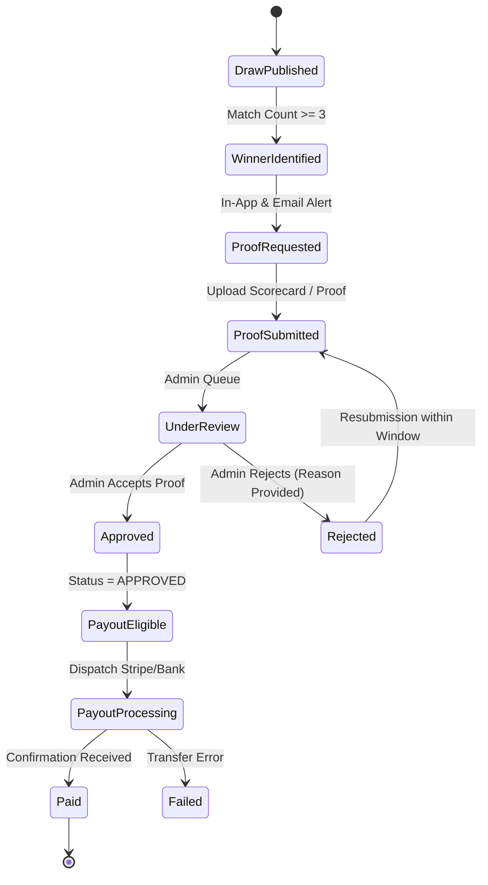

# Business Rules & Ambiguity Analysis Specification

**Document Version:** 1.0.0  
**Status:** Approved for Architecture Review & Decision Approval  
**Critical Notice:** Unresolved business rules and mathematical derivations are analyzed with concrete configurable options. As mandated, no ambiguous rules are unilaterally assumed or hardcoded.  

---

## 1. Core Platform Business Rules

### 1.1 Golf Scores Management
1. **Value Range:** Every golf score submission must be an integer between `1` and `45` inclusive (`score_value >= 1 AND score_value <= 45`).
2. **Date Required:** The date of play (`played_at`) is mandatory and cannot be a future date (`played_at <= CURRENT_DATE`).
3. **Active Score Limit (5 Scores):** A subscriber can have at most five active scores at any time (`is_active = TRUE`).
4. **Chronological Ordering & Archival (FIFO):**
   - Active scores are ordered newest to oldest based on `played_at DESC, created_at DESC`.
   - When a 6th score is submitted, the system automatically marks the oldest active score as archived (`is_active = FALSE`, `archived_at = NOW()`).
5. **Editing:** Subscribers may edit or delete active scores. Any modification updates the `updated_at` timestamp and audits the change.
6. **Concurrency Safety:** Score submissions and archival operations execute within a transactional boundary using row locks (`SELECT ... FOR UPDATE WHERE user_id = $1 AND is_active = TRUE`) to eliminate race conditions during rapid concurrent requests.

---

### 1.2 Monthly Prize Draws
1. **Match Categories:**
   - **5-Number Match:** Top jackpot tier.
   - **4-Number Match:** Mid prize tier.
   - **3-Number Match:** Consolation prize tier.
2. **Draw Modes:**
   - **Random Mode:** Unbiased uniform random selection of 5 distinct numbers from `[1, 45]` using a cryptographically secure pseudorandom number generator (CSPRNG via Node.js `crypto.randomInt`).
   - **Frequency-Weighted Mode:** Weighted probability selection where numbers are sampled without replacement according to empirical score frequency distributions.
3. **Execution Frequency:** Monthly automated draw execution on a configurable scheduled date/time.
4. **Duplicate Prevention:**
   - Each subscriber receives exactly one draw entry per subscribed unit per draw cycle.
   - Once a draw status moves to `PUBLISHED`, results, matches, and allocations are immutable.
5. **Simulation Isolation:**
   - Administrative simulations run in an isolated execution sandbox.
   - Simulations write exclusively to `draw_simulations` and never modify official results, prize pools, or user balances.

---

### 1.3 Prize Pool & Financial Distribution
1. **Default Tier Distribution:**
   - **5-Number Match Tier:** 40% of the active prize pool.
   - **4-Number Match Tier:** 35% of the active prize pool.
   - **3-Number Match Tier:** 25% of the active prize pool.
2. **Equal Split:** Within any winning tier, the allocated funds are divided equally among all eligible winners:
   $$\text{PayoutPerWinner} = \lfloor \frac{\text{TierAllocationCents}}{\text{WinnerCount}} \rfloor$$
   Any fractional minor unit remainder (cents/pence) is retained in the rollover reserve.
3. **Jackpot Rollover:** If a tier produces zero winners, 100% of that tier's allocated funds roll over into the same tier for the next monthly draw.
4. **Revenue Segregation:** Subscription revenue is strictly segmented:
   - **Charity Allocation:** Mandatory $\ge 10\%$ of revenue.
   - **Prize Pool Allocation:** Configurable percentage (e.g., 50%).
   - **Platform & Processing Reserve:** Remainder covers payment gateway fees, hosting, and platform margin.

---

### 1.4 Charity & Philanthropy Rules
1. **Charity Directory:** Certified non-profit directory with search, filtering by category, and featured spotlights.
2. **Mandatory Minimum Allocation:** Subscribers must designate at least 10.00% of their subscription fee to a chosen registered charity.
3. **Configurable Allocation:** Subscribers can adjust their contribution percentage anywhere between 10.00% and 100.00% via the subscriber dashboard.
4. **Independent Donations:** Subscribers and public donors can execute standalone one-off donations directly to any listed charity via Stripe Checkout.

---

### 1.5 Winner Verification & Payout Lifecycle

- **Verification Statuses:** `PENDING`, `APPROVED`, `REJECTED`.
- **Payout Statuses:** `PENDING`, `PROCESSING`, `PAID`, `FAILED`.

---

## 2. In-Depth Analysis of Business Ambiguities & Recommended Solutions

The prompt explicitly identifies 12 critical business ambiguities. Below is a comprehensive breakdown of each ambiguity, outlining viable architectural alternatives and the recommended configurable solution awaiting user approval.

---

### 2.1 Ambiguity 1: Stableford-to-Five-Number Derivation (CRITICAL)

#### Problem Statement
Amateur golfers typically record 18-hole Stableford scores (e.g., 34 points, 38 points) or individual hole points (0-4 points per hole). However, the monthly draw requires a **5-number ticket** where each number is in the range `[1, 45]`. The rule for how a golfer's scores translate into their 5-number draw ticket is undefined in standard golf rules.

#### Evaluated Architectural Options
1. **Option A (Direct Active Scores Mapping):**
   - The user's 5 active scores (each already in `[1, 45]`) serve directly as their 5 draw numbers.
   - *Limitation:* What if duplicate scores exist (e.g., player scored 36 twice)? The draw requires 5 unique numbers.
2. **Option B (Deterministic Hole-Score Aggregation / Modulo Hashing):**
   - The system aggregates hole-by-hole scores or combines active scores with a cryptographic HMAC seeded by the draw date to deterministically yield 5 unique numbers in `[1, 45]`.
   - *Limitation:* Less intuitive for players who want to see direct correlation to their scorecards.
3. **Option C (Subscriber-Chosen "Lucky Numbers" Validated by Handicap/Scores):**
   - Subscribers explicitly pick their 5 favorite numbers (1-45), and their active golf scores act as a "multiplier" or eligibility key.
4. **Option D (Configurable Strategy Pattern - RECOMMENDED):**
   - Implement an extensible Strategy Pattern in `DrawEntryService`:
     - **Default Strategy ("Active Scores with Deduplication & Auto-Fill"):** Take the user's active scores (sorted). If fewer than 5 unique scores exist, systematically fill remaining spots using deterministic offset: $((\text{score} + \text{offset}) \pmod{45}) + 1$ or user's registered handicap/seed.
     - **Alternative Strategy ("Player Choice with Score Lock"):** Allow users to select 5 numbers or hit "Sync from Scores".

> [!IMPORTANT]
> **Action Required:** We request client/stakeholder approval on the preferred derivation strategy before implementing the draw entry generator in Phase 7/9.

---

### 2.2 Ambiguity 2: Draw Entry Generation Timing & Mechanics

#### Problem Statement
Are draw tickets created automatically upon monthly subscription renewal, or does the user manually trigger entry after confirming their 5 active scores?

#### Recommended Solution
- **Automated Snapshot at Draw Cutoff (Recommended):**
  - Draw entries are auto-generated 24 hours prior to the scheduled draw (`draw_cutoff_at`).
  - Active subscribers with $\ge 1$ active score have their ticket generated automatically.
  - If a subscriber has fewer than 5 active scores at cutoff, the system auto-populates missing slots via CSPRNG and alerts the user.

---

### 2.3 Ambiguity 3: Historical Score Eligibility & Recency Window

#### Problem Statement
Can a score submitted 8 months ago still be active if the subscriber has not played recently?

#### Recommended Solution
- **Configurable Recency Window (Default: 90 Days):**
  - Scores older than 90 days are flagged as "Stale" but remain active until replaced, OR
  - A strict rule: Only scores recorded within the last 180 days are eligible for official draw entry.
  - Configured as an admin setting: `MAX_SCORE_AGE_DAYS = 90`.

---

### 2.4 Ambiguity 4: Frequency-Weighted Draw Algorithm

#### Problem Statement
How should number weights be calculated in `FREQUENCY_WEIGHTED` mode?

#### Recommended Solution
- Let $F(n)$ be the count of times number $n \in [1, 45]$ appears across all active scores in the platform.
- **Direct Frequency Weighting:**
  $$W(n) = F(n) + \text{smoothing\_factor} \quad (\text{default smoothing} = 1.0)$$
- Numbers with higher appearance among golfers have a proportionally higher probability of being drawn:
  $$P(n) = \frac{W(n)}{\sum_{i \in \text{Available}} W(i)}$$
- Numbers are sampled without replacement until 5 unique numbers are chosen.

---

### 2.5 Ambiguity 5: Prize Pool Funding Percentage & Waterfall

#### Problem Statement
What exact percentage of monthly subscription gross revenue funds the prize pool?

#### Recommended Solution
- **Configurable Waterfall Configuration:**
  - **Gross Subscription Revenue (100%):**
    - Stripe & Gateway Processing Fees: Deducted at cost (approx. $2.9\% + \$0.30$).
    - Charity Contribution: Configurable subscriber choice ($10.00\% - 25.00\%$).
    - Prize Pool Funding: Configured default **45.00%** of net revenue.
    - Platform Operating Margin: Remainder (approx. $30.00\% - 42.00\%$).

---

### 2.6 Ambiguity 6: Charity Contribution Calculation & 10% Minimum

#### Problem Statement
Does the minimum 10% charity contribution apply to the gross payment or net after Stripe processing fees?

#### Recommended Solution
- **Gross Calculation for Transparency (Recommended):**
  - If a user pays $\$20.00/\text{month}$ and selects 10%, exactly $\$2.00$ is credited to the charity ledger (`amount_cents = 200`).
  - This avoids user confusion over fee deductions and ensures marketing compliance with non-profit standards.

---

### 2.7 Ambiguity 7: Refunds, Chargebacks & Draw Eligibility

#### Problem Statement
What happens if a subscription charge is refunded or charged back after a draw entry is created or a prize is won?

#### Recommended Solution
- If a payment is refunded **prior** to the draw execution, the linked `DrawEntry` is invalidated (`is_active = FALSE`).
- If a dispute or chargeback occurs **after** a draw:
  - If the user won a prize, the `Payout` is immediately frozen with status `SUSPENDED_DISPUTE`.
  - The user's account is flagged for administrative review.

---

### 2.8 Ambiguity 8: Jackpot Rollover & Unclaimed Prizes

#### Problem Statement
If a prize is unclaimed or a winner is rejected during verification, does the money roll over or go to charity?

#### Recommended Solution
- **Tier Rollover:** Unwon prizes roll over into the same match tier for the subsequent month.
- **Rejected/Forfeited Winner:** If an approved proof is not supplied within the deadline, the allocated prize is deposited into a `GeneralRolloverPool` or split 50/50 between the next month's 5-match jackpot and the user's selected charity.

---

### 2.9 Ambiguity 9: Cancellation & Mid-Cycle Draw Eligibility

#### Problem Statement
If a user cancels their subscription on day 15 of a 30-day billing cycle, are they eligible for the month's draw?

#### Recommended Solution
- **Grace Period until Period End:** The subscription status remains `ACTIVE` with `cancel_at_period_end = TRUE`. The user remains 100% eligible for all draws occurring prior to `current_period_end`.

---

### 2.10 Ambiguity 10: Multi-Currency, Taxes & Regulatory Compliance

#### Problem Statement
How are multi-currency prize pools and taxable winnings handled?

#### Recommended Solution
- The platform defaults to a single primary currency per market instance (e.g., `USD` in the US, `GBP` in the UK).
- Payouts are issued with explicit tax disclosures (`1099-MISC` threshold notice in the US for prizes $\ge \$600$).
- All gross prize distributions are reported to the user as pre-tax amounts.

---

### 2.11 Ambiguity 11: Winner Verification Deadlines

#### Problem Statement
How long does a winner have to upload proof before the win is forfeited?

#### Recommended Solution
- **30-Calendar-Day Verification Window:**
  - System sends automated notification reminders at Day 1, Day 7, Day 14, Day 21, and Day 28.
  - If no valid scorecard proof is uploaded by Day 30, status transitions to `EXPIRED_FORFEITED`.

---

### 2.12 Ambiguity 12: Payout Methods & Transaction Fees

#### Problem Statement
What payout rails should be supported, and who covers disbursement fees?

#### Recommended Solution
- **Primary Payout Rail:** Stripe Connect Custom/Express accounts or direct ACH/Bank Transfer.
- **Fee Handling:** Platform absorbs payout transfer fees for standard payouts; optional expedited rails deduct the network fee from the disbursed prize amount.
