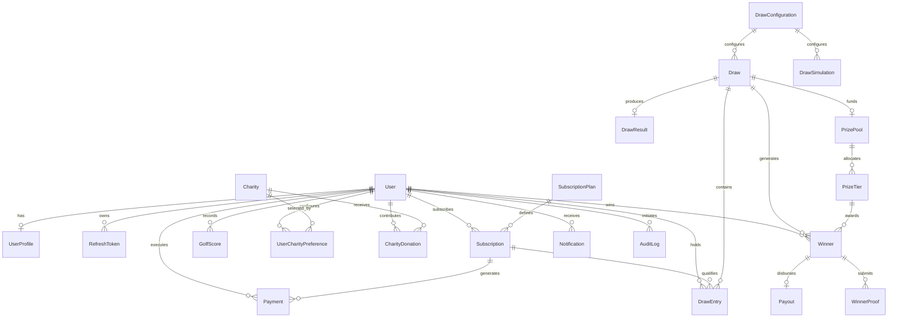

# Database Design Specification: 22 Relational Entities

**Document Version:** 1.0.0  
**Target RDBMS:** PostgreSQL 16+  
**ORM:** TypeORM with Explicit Migrations (`synchronize: false` in production)  
**Financial Standard:** 64-bit Integer Minor Currency Units (`BIGINT`) with ISO 4217 Currency Codes  

---

## 1. High-Level Entity-Relationship Model

---

## 2. Global Database Standards & Conventions

1. **Primary Keys:** UUID v4 (`uuid_generate_v4()`) for non-enumerable, globally unique, distributed identifiers.
2. **Timestamps:** Every mutable entity includes `created_at` (`TIMESTAMPTZ NOT NULL DEFAULT NOW()`) and `updated_at` (`TIMESTAMPTZ NOT NULL DEFAULT NOW()`).
3. **Soft Deletion:** Core auditing entities utilize `deleted_at` (`TIMESTAMPTZ NULL`) where legal/compliance records must not be physically purged.
4. **Financial Arithmetic:** All currencies are stored in minor units (`BIGINT` e.g., cents, pence) alongside an explicit 3-character ISO 4217 currency code (e.g., `USD`, `GBP`, `EUR`). Never use `FLOAT` or `DECIMAL`/`NUMERIC` without explicit rounding rules.
5. **Cascading Rules:** 
   - Restrict/No Action (`ON DELETE RESTRICT`) on financial, transaction, and audit entities (`Payment`, `Payout`, `CharityDonation`, `Winner`, `AuditLog`).
   - Cascade (`ON DELETE CASCADE`) strictly on ephemeral child rows (`RefreshToken`, `UserProfile`).

---

## 3. Detailed Entity Specifications (22 Entities)

### 3.1 `User`
Stores core user authentication credentials, role, and verification status.

- **Table Name:** `users`
- **Columns:**
  - `id`: `UUID` (PK, default: `gen_random_uuid()`)
  - `email`: `VARCHAR(255)` (NOT NULL, UNIQUE, index)
  - `password_hash`: `VARCHAR(255)` (NOT NULL)
  - `role`: `VARCHAR(32)` (NOT NULL, default: `'SUBSCRIBER'`, Check: `IN ('PUBLIC', 'SUBSCRIBER', 'ADMIN')`)
  - `is_email_verified`: `BOOLEAN` (NOT NULL, default: `FALSE`)
  - `verification_token`: `VARCHAR(255)` (NULL)
  - `password_reset_token`: `VARCHAR(255)` (NULL)
  - `password_reset_expires_at`: `TIMESTAMPTZ` (NULL)
  - `stripe_customer_id`: `VARCHAR(255)` (NULL, UNIQUE, index)
  - `status`: `VARCHAR(32)` (NOT NULL, default: `'ACTIVE'`, Check: `IN ('ACTIVE', 'SUSPENDED', 'DEACTIVATED')`)
  - `created_at`: `TIMESTAMPTZ` (NOT NULL, default: `NOW()`)
  - `updated_at`: `TIMESTAMPTZ` (NOT NULL, default: `NOW()`)
- **Indexes:**
  - `idx_users_email` (UNIQUE: `email`)
  - `idx_users_stripe_customer` (UNIQUE: `stripe_customer_id` WHERE `stripe_customer_id IS NOT NULL`)
  - `idx_users_role_status` (`role`, `status`)

---

### 3.2 `UserProfile`
Detailed profile data for a user.

- **Table Name:** `user_profiles`
- **Columns:**
  - `id`: `UUID` (PK, default: `gen_random_uuid()`)
  - `user_id`: `UUID` (NOT NULL, UNIQUE, FK -> `users.id` ON DELETE CASCADE)
  - `first_name`: `VARCHAR(100)` (NOT NULL)
  - `last_name`: `VARCHAR(100)` (NOT NULL)
  - `phone_number`: `VARCHAR(32)` (NULL)
  - `golf_handicap`: `NUMERIC(4, 1)` (NULL)
  - `home_club`: `VARCHAR(150)` (NULL)
  - `country`: `VARCHAR(2)` (NOT NULL, default: `'US'`)
  - `address_line1`: `VARCHAR(255)` (NULL)
  - `address_line2`: `VARCHAR(255)` (NULL)
  - `city`: `VARCHAR(100)` (NULL)
  - `state_province`: `VARCHAR(100)` (NULL)
  - `postal_code`: `VARCHAR(20)` (NULL)
  - `avatar_url`: `TEXT` (NULL)
  - `created_at`: `TIMESTAMPTZ` (NOT NULL, default: `NOW()`)
  - `updated_at`: `TIMESTAMPTZ` (NOT NULL, default: `NOW()`)
- **Indexes:**
  - `idx_user_profiles_user_id` (UNIQUE: `user_id`)

---

### 3.3 `SubscriptionPlan`
Tiered recurring subscription offerings (Monthly, Annual).

- **Table Name:** `subscription_plans`
- **Columns:**
  - `id`: `UUID` (PK, default: `gen_random_uuid()`)
  - `stripe_price_id`: `VARCHAR(255)` (NOT NULL, UNIQUE)
  - `stripe_product_id`: `VARCHAR(255)` (NOT NULL)
  - `name`: `VARCHAR(100)` (NOT NULL)
  - `slug`: `VARCHAR(50)` (NOT NULL, UNIQUE)
  - `interval`: `VARCHAR(20)` (NOT NULL, Check: `IN ('MONTH', 'YEAR')`)
  - `amount_cents`: `BIGINT` (NOT NULL, Check: `amount_cents > 0`)
  - `currency`: `VARCHAR(3)` (NOT NULL, default: `'USD'`)
  - `entries_per_draw`: `INTEGER` (NOT NULL, default: 1)
  - `is_active`: `BOOLEAN` (NOT NULL, default: `TRUE`)
  - `created_at`: `TIMESTAMPTZ` (NOT NULL, default: `NOW()`)
  - `updated_at`: `TIMESTAMPTZ` (NOT NULL, default: `NOW()`)
- **Indexes:**
  - `idx_sub_plans_stripe_price` (UNIQUE: `stripe_price_id`)
  - `idx_sub_plans_slug` (UNIQUE: `slug`)

---

### 3.4 `Subscription`
Individual active subscriber contract synced with Stripe.

- **Table Name:** `subscriptions`
- **Columns:**
  - `id`: `UUID` (PK, default: `gen_random_uuid()`)
  - `user_id`: `UUID` (NOT NULL, FK -> `users.id` ON DELETE RESTRICT)
  - `plan_id`: `UUID` (NOT NULL, FK -> `subscription_plans.id` ON DELETE RESTRICT)
  - `stripe_subscription_id`: `VARCHAR(255)` (NOT NULL, UNIQUE)
  - `status`: `VARCHAR(32)` (NOT NULL, Check: `IN ('TRIALING', 'ACTIVE', 'PAST_DUE', 'CANCELED', 'UNPAID', 'INCOMPLETE')`)
  - `current_period_start`: `TIMESTAMPTZ` (NOT NULL)
  - `current_period_end`: `TIMESTAMPTZ` (NOT NULL)
  - `cancel_at_period_end`: `BOOLEAN` (NOT NULL, default: `FALSE`)
  - `canceled_at`: `TIMESTAMPTZ` (NULL)
  - `created_at`: `TIMESTAMPTZ` (NOT NULL, default: `NOW()`)
  - `updated_at`: `TIMESTAMPTZ` (NOT NULL, default: `NOW()`)
- **Indexes:**
  - `idx_subscriptions_stripe_id` (UNIQUE: `stripe_subscription_id`)
  - `idx_subscriptions_user_status` (`user_id`, `status`)
  - `idx_subscriptions_period_end` (`current_period_end`)

---

### 3.5 `Payment`
Ledger of processed financial charges, invoices, and refunds.

- **Table Name:** `payments`
- **Columns:**
  - `id`: `UUID` (PK, default: `gen_random_uuid()`)
  - `user_id`: `UUID` (NOT NULL, FK -> `users.id` ON DELETE RESTRICT)
  - `subscription_id`: `UUID` (NULL, FK -> `subscriptions.id` ON DELETE RESTRICT)
  - `stripe_payment_intent_id`: `VARCHAR(255)` (NULL, UNIQUE)
  - `stripe_invoice_id`: `VARCHAR(255)` (NULL, UNIQUE)
  - `amount_cents`: `BIGINT` (NOT NULL)
  - `fee_cents`: `BIGINT` (NOT NULL, default: 0)
  - `net_cents`: `BIGINT` (NOT NULL)
  - `currency`: `VARCHAR(3)` (NOT NULL, default: `'USD'`)
  - `status`: `VARCHAR(32)` (NOT NULL, Check: `IN ('PENDING', 'SUCCEEDED', 'FAILED', 'REFUNDED')`)
  - `payment_method_type`: `VARCHAR(50)` (NOT NULL, default: `'card'`)
  - `receipt_url`: `TEXT` (NULL)
  - `idempotency_key`: `VARCHAR(255)` (NOT NULL, UNIQUE)
  - `created_at`: `TIMESTAMPTZ` (NOT NULL, default: `NOW()`)
  - `updated_at`: `TIMESTAMPTZ` (NOT NULL, default: `NOW()`)
- **Indexes:**
  - `idx_payments_stripe_pi` (UNIQUE: `stripe_payment_intent_id` WHERE `stripe_payment_intent_id IS NOT NULL`)
  - `idx_payments_idempotency` (UNIQUE: `idempotency_key`)
  - `idx_payments_user_status` (`user_id`, `status`)

---

### 3.6 `GolfScore`
Subscriber-submitted golf scores (1 to 45). Enforces max 5 active scores.

- **Table Name:** `golf_scores`
- **Columns:**
  - `id`: `UUID` (PK, default: `gen_random_uuid()`)
  - `user_id`: `UUID` (NOT NULL, FK -> `users.id` ON DELETE RESTRICT)
  - `score_value`: `INTEGER` (NOT NULL, Check: `score_value >= 1 AND score_value <= 45`)
  - `played_at`: `DATE` (NOT NULL)
  - `course_name`: `VARCHAR(150)` (NOT NULL)
  - `holes_played`: `INTEGER` (NOT NULL, default: 18, Check: `holes_played IN (9, 18)`)
  - `is_active`: `BOOLEAN` (NOT NULL, default: `TRUE`)
  - `archived_at`: `TIMESTAMPTZ` (NULL)
  - `created_at`: `TIMESTAMPTZ` (NOT NULL, default: `NOW()`)
  - `updated_at`: `TIMESTAMPTZ` (NOT NULL, default: `NOW()`)
- **Indexes:**
  - `idx_golf_scores_user_active_date` (`user_id`, `is_active`, `played_at` DESC)
  - `idx_golf_scores_score_value` (`score_value`)

---

### 3.7 `Charity`
Registered charitable organizations eligible for subscriber donations.

- **Table Name:** `charities`
- **Columns:**
  - `id`: `UUID` (PK, default: `gen_random_uuid()`)
  - `name`: `VARCHAR(200)` (NOT NULL)
  - `slug`: `VARCHAR(220)` (NOT NULL, UNIQUE)
  - `registration_number`: `VARCHAR(100)` (NOT NULL, UNIQUE)
  - `description`: `TEXT` (NOT NULL)
  - `category`: `VARCHAR(100)` (NOT NULL)
  - `logo_url`: `TEXT` (NULL)
  - `website_url`: `TEXT` (NULL)
  - `is_featured`: `BOOLEAN` (NOT NULL, default: `FALSE`)
  - `is_verified`: `BOOLEAN` (NOT NULL, default: `TRUE`)
  - `total_received_cents`: `BIGINT` (NOT NULL, default: 0)
  - `currency`: `VARCHAR(3)` (NOT NULL, default: `'USD'`)
  - `created_at`: `TIMESTAMPTZ` (NOT NULL, default: `NOW()`)
  - `updated_at`: `TIMESTAMPTZ` (NOT NULL, default: `NOW()`)
- **Indexes:**
  - `idx_charities_slug` (UNIQUE: `slug`)
  - `idx_charities_category_featured` (`category`, `is_featured`)

---

### 3.8 `UserCharityPreference`
Subscriber's chosen charity allocation (minimum 10% required).

- **Table Name:** `user_charity_preferences`
- **Columns:**
  - `id`: `UUID` (PK, default: `gen_random_uuid()`)
  - `user_id`: `UUID` (NOT NULL, FK -> `users.id` ON DELETE CASCADE)
  - `charity_id`: `UUID` (NOT NULL, FK -> `charities.id` ON DELETE RESTRICT)
  - `percentage`: `NUMERIC(5, 2)` (NOT NULL, default: 10.00, Check: `percentage >= 10.00 AND percentage <= 100.00`)
  - `is_primary`: `BOOLEAN` (NOT NULL, default: `TRUE`)
  - `created_at`: `TIMESTAMPTZ` (NOT NULL, default: `NOW()`)
  - `updated_at`: `TIMESTAMPTZ` (NOT NULL, default: `NOW()`)
- **Indexes:**
  - `idx_user_charity_pref_user_charity` (UNIQUE: `user_id`, `charity_id`)
  - `idx_user_charity_pref_user_primary` (`user_id`, `is_primary`)

---

### 3.9 `CharityDonation`
Ledger record of funds disbursed or accrued to a charity.

- **Table Name:** `charity_donations`
- **Columns:**
  - `id`: `UUID` (PK, default: `gen_random_uuid()`)
  - `charity_id`: `UUID` (NOT NULL, FK -> `charities.id` ON DELETE RESTRICT)
  - `user_id`: `UUID` (NULL, FK -> `users.id` ON DELETE SET NULL)
  - `payment_id`: `UUID` (NULL, FK -> `payments.id` ON DELETE RESTRICT)
  - `amount_cents`: `BIGINT` (NOT NULL, Check: `amount_cents > 0`)
  - `currency`: `VARCHAR(3)` (NOT NULL, default: `'USD'`)
  - `source_type`: `VARCHAR(32)` (NOT NULL, Check: `IN ('SUBSCRIPTION_PERCENTAGE', 'DIRECT_DONATION', 'ROUND_UP', 'ADMIN_ALLOCATION')`)
  - `status`: `VARCHAR(32)` (NOT NULL, default: `'ACCRUED'`, Check: `IN ('ACCRUED', 'DISBURSED', 'FAILED')`)
  - `disbursed_at`: `TIMESTAMPTZ` (NULL)
  - `created_at`: `TIMESTAMPTZ` (NOT NULL, default: `NOW()`)
  - `updated_at`: `TIMESTAMPTZ` (NOT NULL, default: `NOW()`)
- **Indexes:**
  - `idx_charity_donations_charity_status` (`charity_id`, `status`)
  - `idx_charity_donations_payment_id` (`payment_id`)

---

### 3.10 `DrawConfiguration`
Rules and seed parameters for a draw series.

- **Table Name:** `draw_configurations`
- **Columns:**
  - `id`: `UUID` (PK, default: `gen_random_uuid()`)
  - `name`: `VARCHAR(100)` (NOT NULL)
  - `draw_mode`: `VARCHAR(32)` (NOT NULL, Check: `IN ('RANDOM', 'FREQUENCY_WEIGHTED')`)
  - `min_number`: `INTEGER` (NOT NULL, default: 1)
  - `max_number`: `INTEGER` (NOT NULL, default: 45)
  - `numbers_drawn_count`: `INTEGER` (NOT NULL, default: 5)
  - `prize_distribution_5_match`: `NUMERIC(5, 2)` (NOT NULL, default: 40.00)
  - `prize_distribution_4_match`: `NUMERIC(5, 2)` (NOT NULL, default: 35.00)
  - `prize_distribution_3_match`: `NUMERIC(5, 2)` (NOT NULL, default: 25.00)
  - `rollover_unclaimed`: `BOOLEAN` (NOT NULL, default: `TRUE`)
  - `is_active`: `BOOLEAN` (NOT NULL, default: `TRUE`)
  - `created_at`: `TIMESTAMPTZ` (NOT NULL, default: `NOW()`)
  - `updated_at`: `TIMESTAMPTZ` (NOT NULL, default: `NOW()`)

---

### 3.11 `Draw`
Official monthly draw event.

- **Table Name:** `draws`
- **Columns:**
  - `id`: `UUID` (PK, default: `gen_random_uuid()`)
  - `draw_configuration_id`: `UUID` (NOT NULL, FK -> `draw_configurations.id` ON DELETE RESTRICT)
  - `draw_number`: `INTEGER` (NOT NULL, UNIQUE)
  - `name`: `VARCHAR(150)` (NOT NULL)
  - `scheduled_at`: `TIMESTAMPTZ` (NOT NULL)
  - `executed_at`: `TIMESTAMPTZ` (NULL)
  - `status`: `VARCHAR(32)` (NOT NULL, default: `'SCHEDULED'`, Check: `IN ('SCHEDULED', 'EXECUTING', 'PUBLISHED', 'CANCELED')`)
  - `total_entries_count`: `INTEGER` (NOT NULL, default: 0)
  - `created_at`: `TIMESTAMPTZ` (NOT NULL, default: `NOW()`)
  - `updated_at`: `TIMESTAMPTZ` (NOT NULL, default: `NOW()`)
- **Indexes:**
  - `idx_draws_status_scheduled` (`status`, `scheduled_at`)
  - `idx_draws_draw_number` (UNIQUE: `draw_number`)

---

### 3.12 `DrawResult`
Cryptographic output and winning numbers of an official draw.

- **Table Name:** `draw_results`
- **Columns:**
  - `id`: `UUID` (PK, default: `gen_random_uuid()`)
  - `draw_id`: `UUID` (NOT NULL, UNIQUE, FK -> `draws.id` ON DELETE RESTRICT)
  - `winning_numbers`: `INTEGER[]` (NOT NULL) -- Exactly 5 unique sorted integers in [1, 45]
  - `draw_seed_hash`: `VARCHAR(255)` (NOT NULL) -- SHA-256 seed audit hash
  - `algorithm_mode`: `VARCHAR(32)` (NOT NULL)
  - `published_at`: `TIMESTAMPTZ` (NOT NULL, default: `NOW()`)
  - `created_at`: `TIMESTAMPTZ` (NOT NULL, default: `NOW()`)
- **Indexes:**
  - `idx_draw_results_draw_id` (UNIQUE: `draw_id`)

---

### 3.13 `DrawEntry`
Individual subscriber ticket entered into an official draw.

- **Table Name:** `draw_entries`
- **Columns:**
  - `id`: `UUID` (PK, default: `gen_random_uuid()`)
  - `draw_id`: `UUID` (NOT NULL, FK -> `draws.id` ON DELETE RESTRICT)
  - `user_id`: `UUID` (NOT NULL, FK -> `users.id` ON DELETE RESTRICT)
  - `subscription_id`: `UUID` (NOT NULL, FK -> `subscriptions.id` ON DELETE RESTRICT)
  - `selected_numbers`: `INTEGER[]` (NOT NULL) -- 5 integers in [1, 45]
  - `matched_numbers`: `INTEGER[]` (NULL)
  - `match_count`: `INTEGER` (NOT NULL, default: 0)
  - `is_winner`: `BOOLEAN` (NOT NULL, default: `FALSE`)
  - `created_at`: `TIMESTAMPTZ` (NOT NULL, default: `NOW()`)
- **Indexes:**
  - `idx_draw_entries_draw_user` (`draw_id`, `user_id`)
  - `idx_draw_entries_draw_matches` (`draw_id`, `match_count` DESC)

---

### 3.14 `DrawSimulation`
Isolated sandbox execution of draw algorithms.

- **Table Name:** `draw_simulations`
- **Columns:**
  - `id`: `UUID` (PK, default: `gen_random_uuid()`)
  - `draw_configuration_id`: `UUID` (NOT NULL, FK -> `draw_configurations.id` ON DELETE RESTRICT)
  - `name`: `VARCHAR(150)` (NOT NULL)
  - `simulated_by_user_id`: `UUID` (NOT NULL, FK -> `users.id` ON DELETE RESTRICT)
  - `simulated_entry_count`: `INTEGER` (NOT NULL)
  - `winning_numbers`: `INTEGER[]` (NOT NULL)
  - `simulation_stats`: `JSONB` (NOT NULL) -- Counts of 3, 4, 5 matches, theoretical payouts
  - `created_at`: `TIMESTAMPTZ` (NOT NULL, default: `NOW()`)
- **Indexes:**
  - `idx_draw_simulations_user_created` (`simulated_by_user_id`, `created_at` DESC)

---

### 3.15 `PrizePool`
Financial pool allocated for an official draw.

- **Table Name:** `prize_pools`
- **Columns:**
  - `id`: `UUID` (PK, default: `gen_random_uuid()`)
  - `draw_id`: `UUID` (NOT NULL, UNIQUE, FK -> `draws.id` ON DELETE RESTRICT)
  - `total_pool_cents`: `BIGINT` (NOT NULL)
  - `rollover_in_cents`: `BIGINT` (NOT NULL, default: 0)
  - `rollover_out_cents`: `BIGINT` (NOT NULL, default: 0)
  - `currency`: `VARCHAR(3)` (NOT NULL, default: `'USD'`)
  - `is_finalized`: `BOOLEAN` (NOT NULL, default: `FALSE`)
  - `created_at`: `TIMESTAMPTZ` (NOT NULL, default: `NOW()`)
  - `updated_at`: `TIMESTAMPTZ` (NOT NULL, default: `NOW()`)
- **Indexes:**
  - `idx_prize_pools_draw_id` (UNIQUE: `draw_id`)

---

### 3.16 `PrizeTier`
Distribution tiers (5-match, 4-match, 3-match) within a prize pool.

- **Table Name:** `prize_tiers`
- **Columns:**
  - `id`: `UUID` (PK, default: `gen_random_uuid()`)
  - `prize_pool_id`: `UUID` (NOT NULL, FK -> `prize_pools.id` ON DELETE CASCADE)
  - `match_count`: `INTEGER` (NOT NULL, Check: `match_count IN (3, 4, 5)`)
  - `allocated_percentage`: `NUMERIC(5, 2)` (NOT NULL)
  - `allocated_cents`: `BIGINT` (NOT NULL)
  - `winner_count`: `INTEGER` (NOT NULL, default: 0)
  - `payout_per_winner_cents`: `BIGINT` (NOT NULL, default: 0)
  - `rollover_cents`: `BIGINT` (NOT NULL, default: 0)
  - `created_at`: `TIMESTAMPTZ` (NOT NULL, default: `NOW()`)
  - `updated_at`: `TIMESTAMPTZ` (NOT NULL, default: `NOW()`)
- **Indexes:**
  - `idx_prize_tiers_pool_match` (UNIQUE: `prize_pool_id`, `match_count`)

---

### 3.17 `Winner`
Identified winning participant for a prize tier.

- **Table Name:** `winners`
- **Columns:**
  - `id`: `UUID` (PK, default: `gen_random_uuid()`)
  - `draw_id`: `UUID` (NOT NULL, FK -> `draws.id` ON DELETE RESTRICT)
  - `draw_entry_id`: `UUID` (NOT NULL, UNIQUE, FK -> `draw_entries.id` ON DELETE RESTRICT)
  - `prize_tier_id`: `UUID` (NOT NULL, FK -> `prize_tiers.id` ON DELETE RESTRICT)
  - `user_id`: `UUID` (NOT NULL, FK -> `users.id` ON DELETE RESTRICT)
  - `prize_amount_cents`: `BIGINT` (NOT NULL)
  - `currency`: `VARCHAR(3)` (NOT NULL, default: `'USD'`)
  - `verification_status`: `VARCHAR(32)` (NOT NULL, default: `'PENDING'`, Check: `IN ('PENDING', 'APPROVED', 'REJECTED')`)
  - `verified_by_user_id`: `UUID` (NULL, FK -> `users.id` ON DELETE RESTRICT)
  - `verified_at`: `TIMESTAMPTZ` (NULL)
  - `rejection_reason`: `TEXT` (NULL)
  - `created_at`: `TIMESTAMPTZ` (NOT NULL, default: `NOW()`)
  - `updated_at`: `TIMESTAMPTZ` (NOT NULL, default: `NOW()`)
- **Indexes:**
  - `idx_winners_draw_tier` (`draw_id`, `prize_tier_id`)
  - `idx_winners_user_status` (`user_id`, `verification_status`)

---

### 3.18 `WinnerProof`
Uploaded score verification proof or scorecard media.

- **Table Name:** `winner_proofs`
- **Columns:**
  - `id`: `UUID` (PK, default: `gen_random_uuid()`)
  - `winner_id`: `UUID` (NOT NULL, FK -> `winners.id` ON DELETE CASCADE)
  - `file_url`: `TEXT` (NOT NULL)
  - `file_type`: `VARCHAR(50)` (NOT NULL)
  - `file_size_bytes`: `BIGINT` (NOT NULL)
  - `submitted_notes`: `TEXT` (NULL)
  - `created_at`: `TIMESTAMPTZ` (NOT NULL, default: `NOW()`)
- **Indexes:**
  - `idx_winner_proofs_winner_id` (`winner_id`)

---

### 3.19 `Payout`
Financial disbursement record for an approved winner.

- **Table Name:** `payouts`
- **Columns:**
  - `id`: `UUID` (PK, default: `gen_random_uuid()`)
  - `winner_id`: `UUID` (NOT NULL, UNIQUE, FK -> `winners.id` ON DELETE RESTRICT)
  - `user_id`: `UUID` (NOT NULL, FK -> `users.id` ON DELETE RESTRICT)
  - `amount_cents`: `BIGINT` (NOT NULL)
  - `currency`: `VARCHAR(3)` (NOT NULL, default: `'USD'`)
  - `payout_method`: `VARCHAR(50)` (NOT NULL, Check: `IN ('STRIPE_CONNECT', 'BANK_TRANSFER', 'PAYPAL')`)
  - `payout_reference`: `VARCHAR(255)` (NULL, UNIQUE)
  - `status`: `VARCHAR(32)` (NOT NULL, default: `'PENDING'`, Check: `IN ('PENDING', 'PROCESSING', 'PAID', 'FAILED')`)
  - `failure_reason`: `TEXT` (NULL)
  - `processed_at`: `TIMESTAMPTZ` (NULL)
  - `created_at`: `TIMESTAMPTZ` (NOT NULL, default: `NOW()`)
  - `updated_at`: `TIMESTAMPTZ` (NOT NULL, default: `NOW()`)
- **Indexes:**
  - `idx_payouts_winner_id` (UNIQUE: `winner_id`)
  - `idx_payouts_status` (`status`)

---

### 3.20 `Notification`
User communications regarding draws, winnings, and subscription status.

- **Table Name:** `notifications`
- **Columns:**
  - `id`: `UUID` (PK, default: `gen_random_uuid()`)
  - `user_id`: `UUID` (NOT NULL, FK -> `users.id` ON DELETE CASCADE)
  - `title`: `VARCHAR(255)` (NOT NULL)
  - `message`: `TEXT` (NOT NULL)
  - `type`: `VARCHAR(50)` (NOT NULL, Check: `IN ('DRAW_RESULT', 'WINNER_ALERT', 'PROOF_REQUEST', 'PAYOUT_SENT', 'SUBSCRIPTION_UPDATE', 'GENERAL')`)
  - `is_read`: `BOOLEAN` (NOT NULL, default: `FALSE`)
  - `metadata`: `JSONB` (NULL)
  - `created_at`: `TIMESTAMPTZ` (NOT NULL, default: `NOW()`)
- **Indexes:**
  - `idx_notifications_user_read` (`user_id`, `is_read`, `created_at` DESC)

---

### 3.21 `RefreshToken`
Hashed refresh tokens for secure session rotation.

- **Table Name:** `refresh_tokens`
- **Columns:**
  - `id`: `UUID` (PK, default: `gen_random_uuid()`)
  - `user_id`: `UUID` (NOT NULL, FK -> `users.id` ON DELETE CASCADE)
  - `token_hash`: `VARCHAR(255)` (NOT NULL, UNIQUE)
  - `family_id`: `UUID` (NOT NULL) -- Groups rotated tokens for theft detection
  - `is_revoked`: `BOOLEAN` (NOT NULL, default: `FALSE`)
  - `expires_at`: `TIMESTAMPTZ` (NOT NULL)
  - `created_at`: `TIMESTAMPTZ` (NOT NULL, default: `NOW()`)
- **Indexes:**
  - `idx_refresh_tokens_hash` (UNIQUE: `token_hash`)
  - `idx_refresh_tokens_family` (`family_id`, `is_revoked`)

---

### 3.22 `AuditLog`
Immutable administrative and financial event trail.

- **Table Name:** `audit_logs`
- **Columns:**
  - `id`: `UUID` (PK, default: `gen_random_uuid()`)
  - `actor_user_id`: `UUID` (NULL, FK -> `users.id` ON DELETE SET NULL)
  - `action`: `VARCHAR(100)` (NOT NULL) -- e.g., 'DRAW_PUBLISHED', 'WINNER_APPROVED', 'PAYOUT_EXECUTED'
  - `entity_type`: `VARCHAR(100)` (NOT NULL) -- e.g., 'Draw', 'Winner', 'Payment'
  - `entity_id`: `VARCHAR(255)` (NOT NULL)
  - `details`: `JSONB` (NOT NULL) -- Diff of before/after state, IP address, user agent
  - `ip_address`: `VARCHAR(45)` (NULL)
  - `created_at`: `TIMESTAMPTZ` (NOT NULL, default: `NOW()`)
- **Indexes:**
  - `idx_audit_logs_action_created` (`action`, `created_at` DESC)
  - `idx_audit_logs_entity` (`entity_type`, `entity_id`)

---

## 4. Transaction Boundaries & Isolation Levels

| Operation | Isolation Level | Locking Strategy | Failure Policy |
| :--- | :--- | :--- | :--- |
| **Score Submission & Archival** | `READ COMMITTED` | Row lock `SELECT ... FOR UPDATE` on user's active scores | Rollback on count mismatch |
| **Official Draw Execution** | `SERIALIZABLE` | Advisory Lock `pg_advisory_xact_lock(draw_id)` | Abort if draw is not in `SCHEDULED` status |
| **Prize Allocation** | `SERIALIZABLE` | Table/Row lock on `prize_pools` | Abort if tier percentages != 100% |
| **Winner Verification & Payout** | `REPEATABLE READ`| Row lock on `winners` and `payouts` | Prevent duplicate payout dispatch |
| **Webhook Ledgering** | `READ COMMITTED` | Unique constraint on `idempotency_key` | Idempotent early-exit on duplicate |
